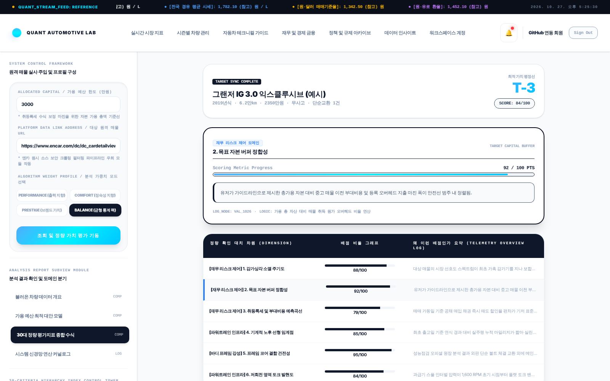
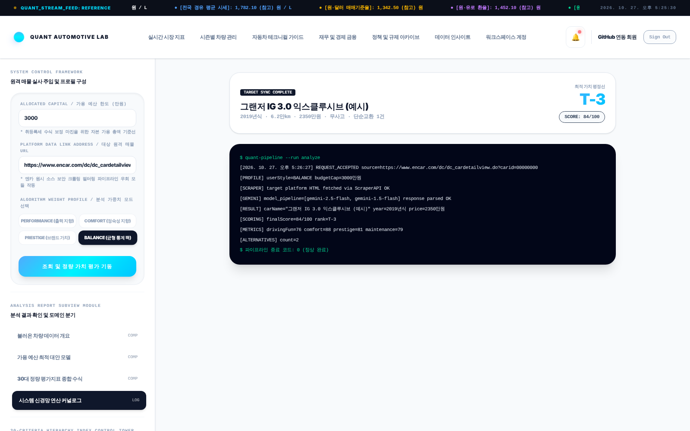
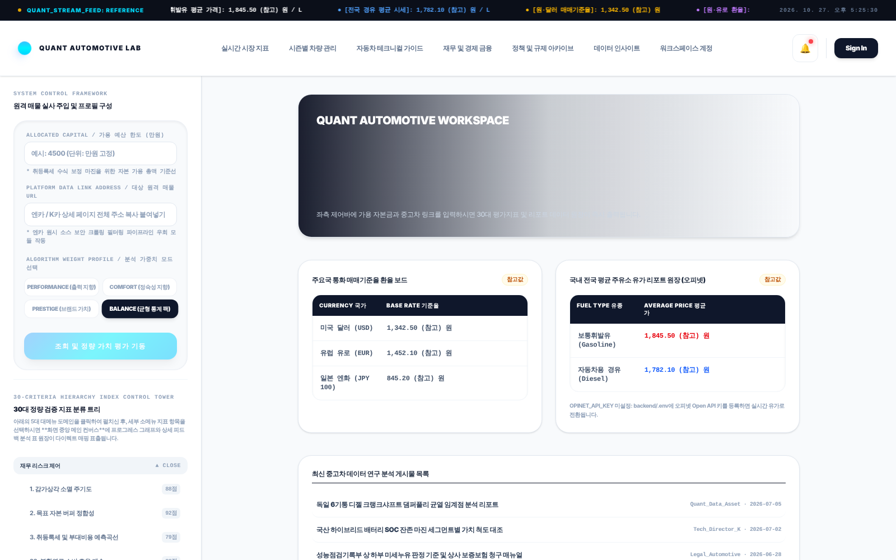
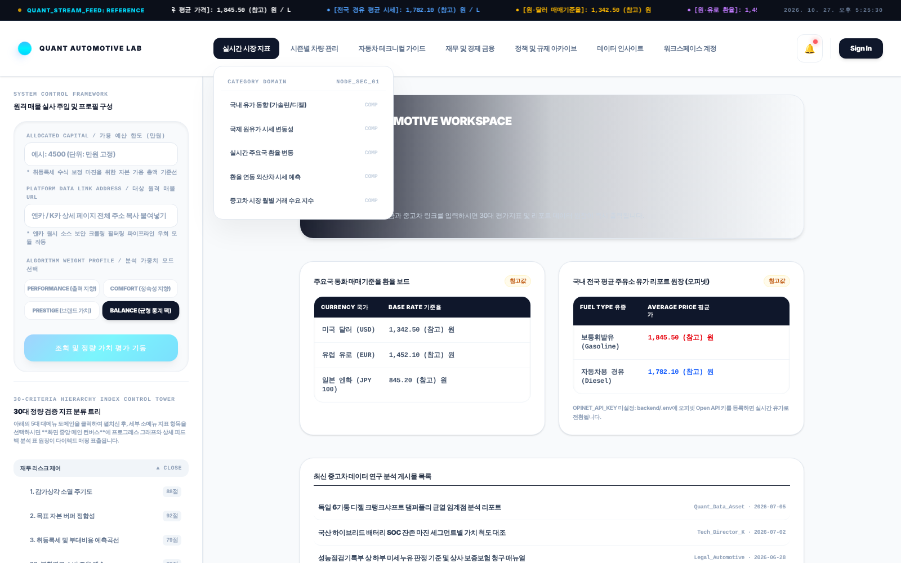
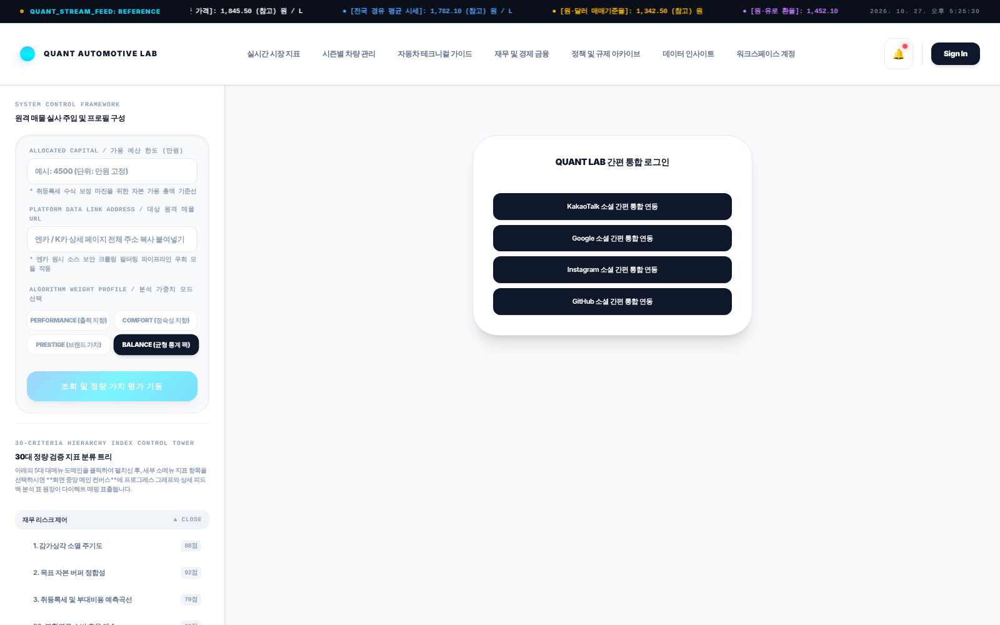
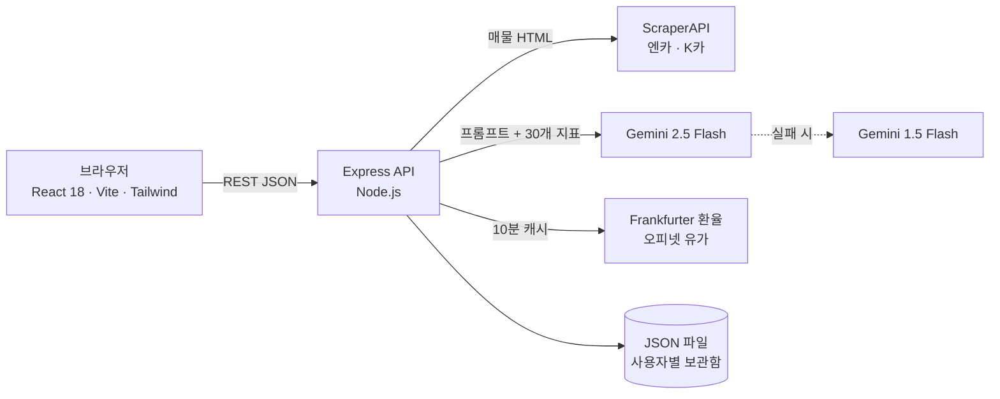
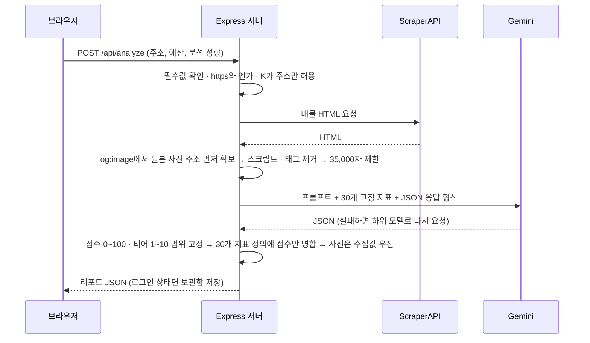

<div align="center">

# Quant Automotive Lab

**매물 링크 하나로 중고차의 가치와 리스크를 30개 지표로 평가하는 웹 앱**<br>
엔카 · K카 매물 정보를 서버가 모으고, LLM이 매긴 점수를 서버에서 한 번 더 검증해 리포트로 보여 줍니다.




</div>

| 항목 | 내용 |
| --- | --- |
| 기간 | 2026.07.08 ~ 2026.07.27 |
| 형태 | 개인 프로젝트 — 기획 · 풀스택 개발 |
| 규모 | 약 1,900줄 · Express API 4개 · 백엔드 런타임 의존성 3개 |
| 핵심 기술 | React 18, Vite 5, Tailwind CSS 4, Node.js(Express 4), Gemini API, ScraperAPI, Frankfurter, 오피넷 Open API |

> 분석 결과는 LLM이 만든 참고 정보이며 실제 차량 점검을 대신하지 않습니다.
> 홈의 게시물 목록, 상단 메뉴 속 표, 30개 지표의 기본 점수는 화면 구성을 위한 예시 데이터입니다.

## 목차

1. [만든 이유](#1-만든-이유)
2. [주요 기능](#2-주요-기능)
3. [시스템 구조](#3-시스템-구조)
4. [분석 API 처리 순서](#4-분석-api-처리-순서)
5. [핵심 설계](#5-핵심-설계)
6. [기술 스택과 선택 이유](#6-기술-스택과-선택-이유)
7. [한계와 개선 방향](#7-한계와-개선-방향)
8. [실행 방법](#8-실행-방법)
9. [폴더 구조](#9-폴더-구조)

## 1. 만든 이유

중고차 매물 페이지만 보고는 가격이 적정한지, 앞으로 어떤 비용과 리스크가 생길지 판단하기 어렵습니다.
정보는 매물 페이지 · 시세 · 유지비 자료에 흩어져 있고, 같은 기준으로 여러 매물을 비교하기도 힘듭니다.

그래서 **매물 주소와 예산만 넣으면** 서버가 매물 정보와 원본 사진을 모으고, 고정된 30개 지표로 점수와 이유를 매겨
한 화면의 리포트로 보여 주는 도구를 만들었습니다.

## 2. 주요 기능

### 매물 분석과 30개 지표 리포트

- 엔카 · K카 매물 주소, 예산(만원), 분석 성향(성능 · 정숙성 · 브랜드 · 균형)을 넣으면 분석을 시작합니다.
- 결과는 **100점 만점 점수와 10단계 티어**, 차량 개요, 예산 안의 대안 모델 2개, 30개 지표 매트릭스로 나뉩니다.
- 30개 지표는 5개 영역으로 고정되어 있고, 지표마다 점수 · 상태 · 이유를 보여 줍니다.

| 영역 | 파워트레인 | 재무 리스크 | 섀시 · 하체 | 캐빈 · NVH | 바디 프레임 |
| --- | :---: | :---: | :---: | :---: | :---: |
| 지표 수 | 8 | 7 | 7 | 5 | 3 |

| 30개 지표 매트릭스 — 지표를 고르면 점수 근거가 위에 열림 | 분석 로그 — 처리 단계별 결과 |
| --- | --- |
|  |  |

> 리포트 화면은 API 키 없이 찍기 위해 **ScraperAPI와 Gemini의 응답만 예시 데이터로 바꾸고**,
> 나머지는 실제 서버 코드(검증 · 범위 고정 · 30개 지표 병합 · 보관함 저장)를 그대로 실행해 캡처했습니다.

### 홈 — 분석 입력과 환율 · 유가 보드

- 왼쪽 패널에서 예산 · 매물 주소 · 분석 성향을 입력하고, 30개 지표 분류 트리를 펼쳐 볼 수 있습니다.
- 환율(USD · EUR · JPY)은 Frankfurter, 유가(휘발유 · 경유)는 오피넷에서 가져옵니다.
- 실시간 조회에 실패하면 화면이 멈추지 않고 **'참고값' 배지**와 함께 기본값을 보여 줍니다.



<sub>외부 시세 API에 접속할 수 없는 환경에서 찍어 '참고값'으로 표시된 상태입니다.</sub>

### 상단 메뉴와 간편 로그인

| 상단 메뉴 — 시장 지표 · 관리 가이드 등 | 간편 로그인(MVP) — 로그인하면 분석이 보관함에 저장 |
| --- | --- |
|  |  |

- 분석 이력은 브라우저에 최근 12건(같은 차종은 최신 1건)을 남기고, 로그인한 경우 서버 보관함에도 저장합니다.
- 작은 화면에서는 입력 패널을 메뉴 버튼으로 여닫고, 버튼 · 알림에는 키보드 포커스 표시와 스크린리더용 라벨을 달았습니다.

## 3. 시스템 구조



화면은 서버 API만 부르고, 외부 API 키는 모두 서버(`backend/.env`)에만 둡니다.

| API | 하는 일 |
| --- | --- |
| `POST /api/analyze` | 매물 주소 · 예산 · 분석 성향을 받아 수집 → LLM 평가 → 서버 검증 후 리포트 JSON 반환, 로그인 상태면 보관함에 저장 |
| `POST /api/auth/login` | MVP 간편 로그인 — 로그인 방식 · 계정 ID로 사용자를 만들거나 찾고 보관함을 함께 반환 |
| `GET /api/assets/:userId` | 사용자별 분석 보관함 조회 |
| `GET /api/market-data` | 환율(USD · EUR · JPY 100엔)과 유가(휘발유 · 경유 · 등유) — 서버에서 10분 캐시 |

## 4. 분석 API 처리 순서



## 5. 핵심 설계

**LLM 응답을 그대로 믿지 않습니다**
- 점수와 티어가 범위를 벗어나도 0~100, 1~10으로 잘라 화면이 깨지지 않게 합니다.
- 30개 지표의 정의(이름 · 영역 · 계산 논리)는 서버가 갖고, 매물마다 받은 점수 · 상태 · 이유만 합칩니다.
  지표 정의는 `frontend/src/data.js` 하나를 서버와 화면이 함께 씁니다.
- 매물 사진은 LLM이 추정한 주소보다 매물 페이지의 `og:image`에서 직접 뽑은 값을 우선합니다.

**외부 API가 실패해도 멈추지 않습니다**
- Gemini 2.5 Flash 호출이 실패하면 1.5 Flash로 다시 요청합니다.
- 환율 · 유가 조회는 따로 실패를 처리해, 한쪽이 실패해도 다른 쪽은 보여 주고 실패한 쪽은 '참고값'으로 표시합니다.
- 오피넷 키가 없으면 유가 칸에 키를 등록하는 방법을 안내합니다.

**비용과 키를 지킵니다**
- API 키는 서버 `.env`에만 두고, 화면에는 서버 주소(`VITE_API_BASE_URL`)만 넘깁니다. 필수 키가 없으면 서버가 시작하지 않고 이유를 알려 줍니다.
- https와 엔카 · K카 주소만 받아, 아무 주소나 수집하느라 스크래핑 크레딧이 새는 일을 막습니다.
- LLM에 보내는 본문은 35,000자로 제한하고, 시세는 서버에서 10분 동안 캐시해 외부 호출을 줄입니다.

## 6. 기술 스택과 선택 이유

| 영역 | 기술 | 선택 이유 |
| --- | --- | --- |
| 화면 | React 18, Vite 5 | 리포트 화면 전환과 입력 상태가 많아 컴포넌트 단위로 관리, 빠른 개발 서버 |
| 스타일 | Tailwind CSS 4 | 대시보드형 화면을 빠르게 맞추고 반응형 처리 |
| 서버 | Node.js, Express 4 | API 4개 규모에 맞는 가벼운 구성, 화면과 같은 JavaScript |
| 수집 | ScraperAPI | 매물 페이지 수집을 대행해 차단 · 렌더링 문제를 서버 코드에서 분리 |
| 평가 | Gemini API | JSON 형식 응답으로 30개 지표 점수와 이유를 한 번에 생성 |
| 시세 | Frankfurter, 오피넷 Open API | 키 없이 쓰는 환율 API, 국내 유가 공식 데이터 |
| 저장 | JSON 파일 | MVP 단계에서 설치 없이 사용자별 보관함 유지 |

## 7. 한계와 개선 방향

| 한계 | 개선 방향 |
| --- | --- |
| 비밀번호 없는 MVP 간편 로그인이라 보관함 조회에 권한 검사가 없음 | 세션 · 비밀번호 해시 · 권한 미들웨어 — 이후 [B1H4 Workspace](https://github.com/yuhiove2425-alt/b1h4-workspace)에서 직접 구현 |
| LLM이 일부 지표를 빠뜨리면 그 지표는 기본 예시 점수로 채워짐 | 누락 지표는 '평가 없음'으로 표시하고 응답 형식 검증 추가 |
| 요청 횟수 제한과 허용 출처(CORS) 제한이 없음 | 요청 제한과 허용 출처 설정으로 외부 API 크레딧 보호 |
| 매물 페이지 구조가 바뀌면 수집 품질이 떨어짐 | 사이트별 추출 규칙과 수집 실패 감지 |

## 8. 실행 방법

필요한 것: Node.js 18 이상, [ScraperAPI](https://www.scraperapi.com/) 키, [Google AI Studio](https://aistudio.google.com/)의 Gemini API 키

```bash
# 1) 백엔드
cd backend
cp .env.example .env      # SCRAPER_API_KEY, GEMINI_API_KEY 입력
npm install
npm start                 # http://localhost:5000

# 2) 프론트엔드 (새 터미널)
cd frontend
cp .env.example .env      # VITE_API_BASE_URL=http://localhost:5000
npm install
npm run dev               # http://localhost:5173
```

Windows에서는 `backend/.env`를 만든 뒤 `start.bat`을 실행하면 의존성 설치와 서버 · 화면 실행을 한 번에 합니다.

| 환경 변수 | 위치 | 필수 | 설명 |
| --- | --- | :---: | --- |
| `SCRAPER_API_KEY` | backend | ✓ | 매물 페이지 수집 |
| `GEMINI_API_KEY` | backend | ✓ | 매물 평가 |
| `PORT` | backend | | 서버 포트 (기본 5000) |
| `OPINET_API_KEY` | backend | | 실시간 유가 — 없으면 참고값 표시 |
| `VITE_API_BASE_URL` | frontend | | 서버 주소 (기본 `http://localhost:5000`) |

`.env`와 실행 중 생기는 `backend/data/`(보관함)는 `.gitignore`로 커밋하지 않습니다.

## 9. 폴더 구조

```
quant-automotive-lab/
├─ backend/
│  ├─ server.js         # Express API 4개 — 분석 · 간편 로그인 · 보관함 · 시세
│  └─ .env.example      # 환경 변수 예시 (실제 .env는 커밋하지 않음)
├─ frontend/
│  ├─ src/App.jsx       # 화면 전환 · 분석 요청 · 리포트
│  ├─ src/Sidebar.jsx   # 입력 패널 · 30개 지표 분류 트리 · 리포트 메뉴
│  ├─ src/MegaNav.jsx   # 상단 메뉴 · 시세 흐름 표시 · 알림 · 로그인
│  ├─ src/data.js       # 30개 지표 정의(서버와 공유) · 메뉴 · 예시 콘텐츠
│  └─ .env.example
├─ docs/screenshots/    # README 화면 캡처
└─ start.bat            # Windows에서 한 번에 실행
```

---

만든 사람: **김유현** — 개인 프로젝트, 기획부터 화면 · 서버 · 외부 API 연동까지 직접 개발했습니다.
