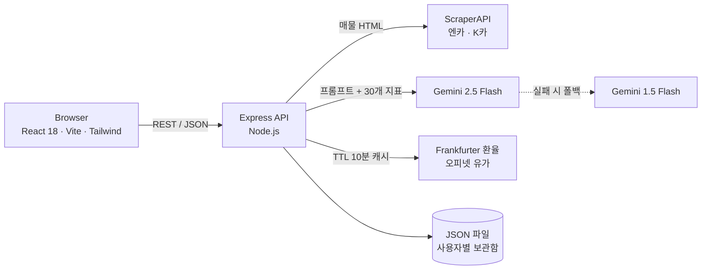
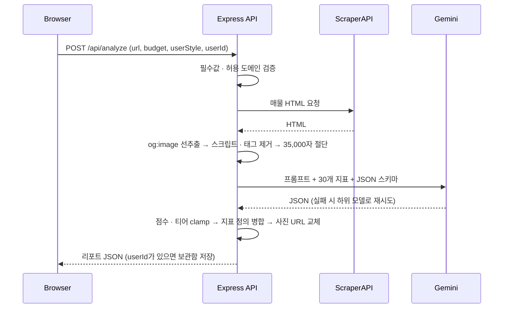

<div align="center">

# Quant Automotive Lab

**LLM 기반 중고차 가치 · 리스크 분석 웹 애플리케이션**

엔카 · K카 매물 URL을 입력하면 서버가 매물 데이터를 수집하고, Gemini가 산출한 평가를 서버에서 검증 · 정규화해<br>
**100점 만점 점수 · 10단계 티어 · 30개 지표 리포트**로 제공합니다.


</div>

<br>

| | |
| --- | --- |
| **기간** | 2026.07.08 – 2026.07.27 |
| **유형** | 개인 프로젝트 — 기획, 프론트엔드, 백엔드, 외부 API 연동 전 과정 |
| **규모** | 약 1,900 LOC · REST API 4개 · 백엔드 런타임 의존성 3개 |
| **스택** | React · Vite · Tailwind CSS · Node.js · Express · Gemini API · ScraperAPI |

## Overview

**Problem** — 중고차 매물 페이지만으로는 가격 적정성, 향후 유지비, 잠재 리스크를 판단하기 어렵고 매물 간 비교 기준도 일정하지 않습니다.

**Solution** — 매물 URL · 예산 · 분석 성향을 입력받아 서버가 `수집 → LLM 평가 → 검증 · 정규화`를 수행하고, 고정된 30개 지표 기준의 리포트를 반환합니다.

**Highlights**

- **LLM 출력 검증** — 점수 · 티어 범위 고정, 서버가 가진 지표 정의에 점수만 병합, 수집한 사실(매물 사진)을 LLM 추정값보다 우선
- **장애 격리** — 모델 폴백(`gemini-2.5-flash → gemini-1.5-flash`), 시세 소스별 부분 실패 처리와 `live` 플래그 기반 UI 표시
- **비용 통제** — 수집 대상 도메인 허용 목록, LLM 입력 35,000자 상한, 시세 서버 캐시(TTL 10분)
- **비밀 정보 관리** — API 키는 서버 환경 변수에만 보관, 필수 키 누락 시 기동 중단(fail-fast)

## Table of Contents

- [Features](#features)
- [Screenshots](#screenshots)
- [Tech Stack](#tech-stack)
- [Architecture](#architecture)
- [Analysis Pipeline](#analysis-pipeline)
- [API Reference](#api-reference)
- [Data Model](#data-model)
- [Getting Started](#getting-started)
- [Project Structure](#project-structure)
- [Design Decisions](#design-decisions)
- [Troubleshooting](#troubleshooting)
- [Roadmap](#roadmap)
- [Disclaimer](#disclaimer)
- [Author](#author)

## Features

- **매물 분석** — 엔카 · K카 매물 URL, 예산(만원), 분석 성향(`PERFORMANCE` · `COMFORT` · `PRESTIGE` · `BALANCE`)을 입력받아 평가
- **종합 평가** — 100점 만점 점수, 10단계 티어, 주행 · 정숙성 · 브랜드 · 유지비 4개 세부 점수, 대안 모델 2개
- **30개 지표 리포트** — 5개 도메인으로 고정된 지표별 점수 · 상태 · 근거, 지표 선택 시 상세 패널

  | 도메인 | 파워트레인 인프라 | 재무 리스크 제어 | 섀시 하체 제어 | 캐빈 NVH 인슐레이션 | 바디 프레임 강성 |
  | --- | :---: | :---: | :---: | :---: | :---: |
  | 지표 수 | 8 | 7 | 7 | 5 | 3 |

- **시장 지표 보드** — 환율(USD · EUR · JPY 100엔), 전국 평균 유가(휘발유 · 경유), 조회 실패 시 `참고값` 배지
- **분석 이력** — 브라우저에 최근 12건 저장(동일 차종은 최신 1건), 로그인 시 서버 보관함에도 저장
- **반응형 · 접근성** — 모바일에서 입력 패널 토글, 키보드 포커스 표시, `aria-label` · `aria-live` 적용

## Screenshots

| 리포트 — 30개 지표 매트릭스 | 리포트 — 파이프라인 로그 |
| --- | --- |
|  |  |
| **홈 — 분석 입력 · 시장 지표 보드** | **상단 메뉴** |
|  |  |

> [!NOTE]
> 리포트 화면은 API 키 없이 캡처하기 위해 ScraperAPI · Gemini 응답만 예시 데이터로 대체하고, 나머지 서버 로직(검증 · 정규화 · 보관함 저장)은 실제 코드를 그대로 실행했습니다.
> 홈 화면은 외부 시세 API에 접근할 수 없는 환경에서 캡처해 `참고값`으로 표시된 상태입니다.

## Tech Stack

| Layer | Technology | 선택 이유 |
| --- | --- | --- |
| Frontend | React 18, Vite 5 | 리포트 하위 뷰 · 입력 상태가 많아 컴포넌트 단위로 관리, 빠른 HMR |
| Styling | Tailwind CSS 4 | 대시보드형 레이아웃과 반응형을 유틸리티 클래스로 빠르게 구성 |
| Backend | Node.js 20+, Express 4 | API 4개 규모에 맞는 경량 구성, 프론트엔드와 같은 언어 |
| Scraping | ScraperAPI | 매물 페이지 수집(차단 회피 · 렌더링)을 서버 코드와 분리 |
| LLM | Gemini API | JSON 응답으로 30개 지표 점수 · 근거를 한 번에 생성 |
| Market data | Frankfurter, 오피넷 Open API | 키 없이 쓰는 환율 API, 국내 공식 유가 데이터 |
| Storage | JSON 파일 | MVP 단계에서 별도 DB 없이 사용자별 보관함 유지 |

## Architecture



클라이언트는 자체 API 서버만 호출하며, 외부 API 키와 호출은 모두 서버에서 처리합니다.

| 모듈 | 책임 |
| --- | --- |
| `backend/server.js` | REST API, 입력 검증, 수집 · LLM 호출 · 응답 정규화, 시세 캐시, 보관함 저장 |
| `frontend/src/App.jsx` | 뷰 전환(홈 · 로그인 · 리포트), 분석 요청, 이력 관리, 토스트 알림 |
| `frontend/src/Sidebar.jsx` | 입력 폼, 30개 지표 분류 트리, 리포트 하위 메뉴 |
| `frontend/src/MegaNav.jsx` | 상단 메뉴, 시세 티커, 알림 센터, 로그인 상태 |
| `frontend/src/data.js` | 30개 지표 정의(서버와 공유하는 단일 출처), 메뉴 · 예시 콘텐츠 |

## Analysis Pipeline



| # | 단계 | 처리 | 목적 |
| :---: | --- | --- | --- |
| 1 | Validate | 필수값 확인, `https` + `encar.com` · `kcar.com`(하위 도메인 포함)만 허용 | 잘못된 입력 차단, 임의 URL 수집으로 인한 크레딧 소모 방지 |
| 2 | Scrape | ScraperAPI로 매물 HTML 수집 | 수집 안정성 확보 |
| 3 | Extract | `og:image` 선추출 → `script` · `style` · 태그 제거 → 공백 정리 → 35,000자 절단 | 원본 사진 확보, LLM 입력 토큰 상한 |
| 4 | Infer | 30개 지표 목록과 JSON 스키마를 담은 프롬프트, 모델 순차 폴백 | 구조화된 평가 결과 생성 |
| 5 | Normalize | 코드펜스 제거 후 파싱 → `finalScore` 0–100 · `rank` 1–10 clamp → 지표 정의에 점수 · 상태 · 근거 병합 → 수집한 사진 URL 우선 적용 | LLM 출력을 신뢰 가능한 형태로 보정 |
| 6 | Persist | `userId`가 있으면 사용자 보관함에 저장 | 분석 이력 관리 |

## API Reference

- Base URL: `http://localhost:5000` (`PORT`로 변경)
- 요청 · 응답 형식: `application/json`
- 오류 응답 형식: `{ "error": "<message>" }`

| Method | Endpoint | 설명 |
| --- | --- | --- |
| `POST` | `/api/analyze` | 매물 분석 실행, 리포트 반환 |
| `POST` | `/api/auth/login` | MVP 간편 로그인 — 사용자 생성 또는 조회 |
| `GET` | `/api/assets/:userId` | 사용자 보관함 조회 |
| `GET` | `/api/market-data` | 환율 · 유가 조회 (서버 캐시 TTL 10분) |

### `POST /api/analyze`

| 필드 | 타입 | 필수 | 설명 |
| --- | --- | :---: | --- |
| `url` | string | ✓ | `https` 엔카 · K카 매물 상세 URL |
| `budget` | string \| number | ✓ | 예산 (만원) |
| `userStyle` | string | ✓ | `PERFORMANCE` · `COMFORT` · `PRESTIGE` · `BALANCE` |
| `userId` | string \| null | | 로그인 사용자 ID — 있으면 결과를 보관함에 저장 |

```bash
curl -X POST http://localhost:5000/api/analyze \
  -H "Content-Type: application/json" \
  -d '{"url":"https://www.encar.com/dc/dc_cardetailview.do?carid=00000000","budget":"3000","userStyle":"BALANCE"}'
```

<details>
<summary><b>200 OK</b> — 응답 예시 (일부 생략)</summary>

```json
{
  "carName": "그랜저 IG 3.0 익스클루시브",
  "price": 2350,
  "year": "2019년식",
  "mileage": "6.2만km",
  "accident": "무사고 · 단순교환 1건",
  "imageUrl": "https://…/listing-photo.jpg",
  "finalScore": 84,
  "rank": 3,
  "metrics": {
    "drivingFun":  { "score": 76, "comment": "…" },
    "comfort":     { "score": 88, "comment": "…" },
    "prestige":    { "score": 81, "comment": "…" },
    "maintenance": { "score": 79, "comment": "…" }
  },
  "alternatives": [
    { "model": "…", "reason": "…", "imageUrl": "…" }
  ],
  "criteria": [
    {
      "id": 1,
      "component": "재무 리스크 제어",
      "title": "Depreciation Decay Index",
      "name": "감가상각 소멸 주기도",
      "score": 88,
      "status": "최상위 방어",
      "logic": "MSRP 가격 낙하 곡선 안정화 마진율 계측 연산 수식",
      "reason": "…"
    }
  ]
}
```

`criteria`는 항상 30개 항목이며, 지표 정의(`id` · `component` · `title` · `name` · `logic`)는 서버가 고정하고 `score` · `status` · `reason`만 매물별로 채워집니다.

</details>

| Status | 조건 |
| --- | --- |
| `400` | `url` · `budget` · `userStyle` 중 누락 (`필수 매개변수 누락`) |
| `400` | `https` 엔카 · K카 주소가 아님 |
| `500` | 매물 수집 실패, 모든 모델 호출 실패, LLM 응답 파싱 실패 |

### `POST /api/auth/login`

| 필드 | 타입 | 설명 |
| --- | --- | --- |
| `type` | string | 로그인 방식 (예: `GitHub`) |
| `accountId` | string | 계정 ID — 사용자 키는 `${type}_${accountId}` |
| `name` | string | 표시 이름 |

<details>
<summary><b>200 OK</b> — 응답 예시</summary>

```json
{
  "user": { "id": "GitHub_GitHub_DEMO_USER", "type": "GitHub", "name": "GitHub 연동 회원", "createdAt": "2026-07-27T06:05:18.293Z" },
  "savedAssets": []
}
```

</details>

### `GET /api/assets/:userId`

사용자 보관함의 분석 결과 목록을 최신순으로 반환합니다. 존재하지 않는 사용자는 빈 배열을 반환합니다.

```json
{ "savedAssets": [ { "id": 1753596318293, "carName": "…", "finalScore": 84, "...": "analyze 응답 필드" } ] }
```

### `GET /api/market-data`

| 필드 | 설명 |
| --- | --- |
| `exchange.usd` · `eur` · `jpy` | 원화 환율 (`jpy`는 100엔 기준) |
| `exchange.date` | 환율 기준일 |
| `fuel.gasoline` · `diesel` · `kerosene` | 전국 평균 유가 (원/L) |
| `exchange.live` · `fuel.live` | 실시간 조회 성공 여부 — `false`면 UI가 `참고값`으로 표시 |
| `fuel.note` | 오피넷 키 미설정 시 안내 문구 |
| `fetchedAt` | 조회 시각 (ISO 8601) |

<details>
<summary><b>200 OK</b> — 외부 조회 실패 시 응답 예시</summary>

```json
{
  "exchange": { "live": false },
  "fuel": { "live": false, "note": "OPINET_API_KEY 미설정: backend/.env에 오피넷 Open API 키를 등록하면 실시간 유가로 전환됩니다." },
  "fetchedAt": "2026-10-27T08:37:13.159Z"
}
```

</details>

## Data Model

**서버 — `backend/data/db.json`** (최초 저장 시 자동 생성, Git 추적 제외)

```jsonc
{
  "users": {
    "<type>_<accountId>": { "id": "...", "type": "GitHub", "name": "...", "createdAt": "ISO 8601" }
  },
  "assets": {
    "<type>_<accountId>": [ { "id": 1753596318293, /* analyze 응답 필드 */ } ]  // 최신순
  }
}
```

**클라이언트 — `localStorage`** : `QUANT_WORKSPACE_MASTER_LOGS_V4` 키에 최근 분석 12건 저장 (동일 `carName`은 최신 1건만 유지)

## Getting Started

### Prerequisites

- Node.js **20 이상** (Tailwind CSS 4 엔진 요구 사항)
- [ScraperAPI](https://www.scraperapi.com/) API 키
- [Google AI Studio](https://aistudio.google.com/) Gemini API 키
- 선택: [오피넷](https://www.opinet.co.kr/) Open API 키 (실시간 유가)

### Installation

```bash
git clone https://github.com/yuhiove2425-alt/quant-automotive-lab.git
cd quant-automotive-lab

# Backend
cd backend
cp .env.example .env        # SCRAPER_API_KEY, GEMINI_API_KEY 입력
npm install
npm start                   # http://localhost:5000

# Frontend (새 터미널)
cd frontend
cp .env.example .env
npm install
npm run dev                 # http://localhost:5173
```

Windows에서는 `backend/.env` 작성 후 `start.bat`을 실행하면 의존성 설치와 서버 · 클라이언트 실행을 한 번에 처리합니다.

### Environment Variables

| 변수 | 위치 | 필수 | 기본값 | 설명 |
| --- | --- | :---: | --- | --- |
| `SCRAPER_API_KEY` | `backend/.env` | ✓ | — | ScraperAPI 키 (매물 수집) |
| `GEMINI_API_KEY` | `backend/.env` | ✓ | — | Gemini API 키 (매물 평가) |
| `PORT` | `backend/.env` | | `5000` | API 서버 포트 |
| `OPINET_API_KEY` | `backend/.env` | | — | 오피넷 키 — 미설정 시 유가는 `참고값` 표시 |
| `VITE_API_BASE_URL` | `frontend/.env` | | `http://localhost:5000` | API 서버 주소 |

> [!IMPORTANT]
> `.env` 파일과 `backend/data/`는 `.gitignore`로 커밋에서 제외됩니다. 키는 `.env.example`을 복사해 로컬에서만 입력하세요.

### Scripts

| 위치 | 명령 | 설명 |
| --- | --- | --- |
| `backend` | `npm start` | API 서버 실행 |
| `frontend` | `npm run dev` | 개발 서버 실행 (HMR) |
| `frontend` | `npm run build` | 프로덕션 빌드 (`dist/`) |
| `frontend` | `npm run preview` | 빌드 결과 미리보기 |

## Project Structure

```
quant-automotive-lab/
├── backend/
│   ├── server.js           # REST API · 분석 파이프라인 · 시세 캐시 · 보관함
│   ├── package.json
│   └── .env.example
├── frontend/
│   ├── src/
│   │   ├── App.jsx         # 뷰 전환 · 분석 요청 · 이력 관리
│   │   ├── Sidebar.jsx     # 입력 폼 · 30개 지표 트리 · 리포트 메뉴
│   │   ├── MegaNav.jsx     # 상단 메뉴 · 시세 티커 · 알림 · 로그인
│   │   ├── data.js         # 30개 지표 정의 (서버와 공유) · 메뉴 · 예시 콘텐츠
│   │   ├── main.jsx
│   │   └── index.css
│   ├── index.html
│   ├── vite.config.js
│   ├── package.json
│   └── .env.example
├── docs/screenshots/
└── start.bat               # Windows 원클릭 실행
```

## Design Decisions

| 결정 | 이유 | 구현 |
| --- | --- | --- |
| LLM 출력은 서버에서 정규화 | LLM은 범위를 벗어난 값 · 누락 필드를 낼 수 있음 | `finalScore` · `rank` clamp, 고정 지표 정의에 점수만 병합 |
| 수집한 사실을 LLM 추정보다 우선 | LLM이 만든 이미지 URL은 실제 매물과 다를 수 있음 | 태그 제거 전에 `og:image`를 추출해 `imageUrl` 덮어쓰기 |
| 지표 정의의 단일 출처 | 서버 프롬프트 · 응답 병합과 UI 트리가 어긋나지 않도록 | 서버가 `frontend/src/data.js`의 `CRITERIA_COMPREHENSIVE_30`을 import |
| 외부 의존 실패를 격리 | 한 소스의 장애로 전체 화면이 멈추지 않도록 | 모델 순차 폴백, 환율 · 유가 개별 `catch`, `live` 플래그로 UI 상태 표시 |
| 비용 상한 설정 | 스크래핑 크레딧과 LLM 토큰은 호출당 과금 | 도메인 허용 목록, 입력 35,000자 절단, 시세 서버 캐시 10분 · 클라이언트 갱신 5분 |
| 키는 서버에만 두고 fail-fast | 클라이언트 번들에 키가 노출되지 않도록, 잘못된 설정을 조기에 발견 | 키는 `backend/.env`에서만 로드, 필수 키 누락 시 프로세스 종료 |

## Troubleshooting

| 증상 | 원인 · 해결 |
| --- | --- |
| 서버가 시작 직후 `필수 환경변수 누락`을 출력하고 종료 | `backend/.env`에 `SCRAPER_API_KEY` · `GEMINI_API_KEY` 설정 |
| `지원하지 않는 플랫폼 주소입니다` 오류 | `https`로 시작하는 엔카 · K카 매물 상세 URL인지 확인 |
| 환율 · 유가에 `참고값` 배지 표시 | 외부 시세 API 조회 실패 또는 `OPINET_API_KEY` 미설정 — 캐시 만료(10분) 후 재조회 |
| 화면에서 분석 요청이 실패 | `frontend/.env`의 `VITE_API_BASE_URL`이 API 서버 주소와 같은지 확인 후 개발 서버 재시작 |

## Roadmap

현재 버전은 MVP이며, 다음 항목을 알려진 한계로 관리합니다.

- [ ] **인증 · 인가** — 비밀번호 없는 간편 로그인으로 보관함 조회에 권한 검사가 없음 → 세션 · 비밀번호 해시 · 권한 미들웨어 도입 (후속 프로젝트 [B1H4 Workspace](https://github.com/yuhiove2425-alt/b1h4-workspace)에서 구현)
- [ ] **응답 스키마 검증** — LLM이 일부 지표를 누락하면 기본 예시 값으로 채워짐 → 스키마 검증 후 `평가 없음`으로 표시
- [ ] **API 보호** — 요청 횟수 제한, CORS 허용 출처 지정으로 외부 API 크레딧 보호
- [ ] **캐시 정책** — 시세 조회 실패 결과도 10분간 캐시됨 → 실패 시 짧은 TTL로 재조회
- [ ] **수집 안정성** — 사이트별 추출 규칙과 수집 실패 감지
- [ ] **테스트** — 외부 API를 목 처리한 API 통합 테스트

## Disclaimer

- 분석 결과는 LLM이 생성한 참고 정보이며 실제 차량 점검을 대신하지 않습니다.
- 홈 게시물 목록, 상단 메뉴의 표, 30개 지표의 기본 점수 · 근거는 화면 구성을 위한 예시 데이터입니다.

## Author

**김유현** — Backend Developer · [GitHub](https://github.com/yuhiove2425-alt)

개인 프로젝트로 기획부터 프론트엔드 · 백엔드 · 외부 API 연동까지 전 과정을 직접 개발했습니다.
